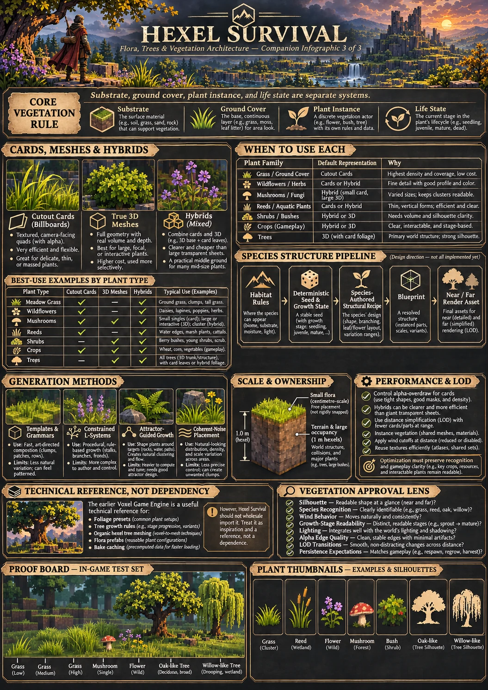

# Vegetation structure, rendering and authored-assets integration

**Scope:** plant structural blueprints, algorithm choices, owner/harvest
state, foliage rendering and the older Voxel Game Engine reference.
These details were moved from the canonical style guide so that
[the style guide](../assets/STYLE_GUIDE.md) focuses on appearance and
visual acceptance. This is a design contract and research plan, **not**
an implemented vegetation renderer or approved species roster.

For research registry and species-to-asset bindings, use
[Flora to assets](flora-to-assets.md); for game/editor boundary and
authoritative edits, use [integration](integration.md).
The standalone headless [SCA research prototype](../src/space_colonization.rs)
was merged through [PR #30](https://github.com/sdhaight1-hash/Hexel-survival-game/pull/30). It is
not yet integrated with production vegetation rendering or growth.

## Illustrated structural references



*Original concept illustration, retained from the former overloaded style
guide. Its geometry and examples are illustrative, not current runtime
features or canonical leaf-card/hexel dimensions. The written contracts
below control actual implementation.*

[Space-colonization reuse diagram](../assets/diagrams/spatial-growth-consumers.svg)
shows where selected vines, roots and exceptional branches can consume
shared skeleton geometry without becoming mandatory for common flora.

## Plant structure generation is separate from appearance and ecology

**Core architectural rule:** *where a plant can grow*, *which structure
its recipe creates*, *how its life state changes*, and *how its mesh/cards
are rendered* are **four distinct responsibilities**.

```text
Habitat/placement + approved species rules
    -> deterministic plant instance + growth state
    -> species-authored structural recipe
    -> versioned structural blueprint (wood, twigs, leaf sites, bounds)
    -> rendered near/far mesh, leaf cards, textures and wind
```

The blueprint is a **design target**, not an already shipped type in
Hexel Survival. It should permit several growth stages and different
render meshes/LODs without letting a material texture become the authority
for plant identity, fertility or resources. A 3D plant can have a 2D-card
leaf crown; an L-system tree need not be rendered with individual voxels.

**Algorithm choices and intended role:**

| Approach | Intended use | Status / constraint |
| --- | --- | --- |
| **Species-authored templates and parametric branching grammars** | Default for ordinary grass clusters, flowers, mushrooms, crops, common trees and shrubs | **Preferred first implementation.** Predictable and artist-directed; vary seeds within species bounds |
| **Constrained/parametric L-systems** | Selected branching trees, vines and woody plants with distinctive branching rhythms | **Candidate advanced authoring tool**, not mandatory, not currently a general L-system engine in either runtime |
| **Space-colonization / attractor-guided growth** | Special spreading/ancient trees, unusual canopies and obstacle-responsive growth | **Candidate specialized precompute/cached authoring**; the old editor's *CanopyGuided* mode is only inspired by this idea, **not** a full iterative space-colonization solver |
| **Coherent noise / weighted scatter** | Habitat patch placement, crown irregularity, cover density, bounded structural variation | **Foundational candidate**; noise placement is not itself plant biology, and noise-driven 3D shapes do not replace authored species forms |

Do **not** call L-systems an automatic realism guarantee or implement
multiple full generators merely for completeness. Even mathematically
complex branches require authored crown envelopes, taper, phyllotaxy,
leaf arrangement, gravity response and silhouette constraints.
Space-colonization attractors are **geometric targets**, not
automatically a simulation of actual sunlight or nutrients.
Use these algorithms **offline or on controlled regeneration events**,
not as repeated work every render frame.

**Species examples:** oak may use heavy, irregular limbs and broad
crown lobes; pine regular branching tiers and needle sprays; willow
drooping curtains and riparian habit; larch spur needles; palms crown
fronds; mushrooms usually need no branching solver at all.
All shape parameters are **artistic/biological approximations** until
validated, not measured universal botanical constants.

## Plant size, hexel ownership and persistent life state

- The demo's **1m-across-flats, 1m-tall hexels** describe the terrain
  substrate and can describe *harvestable wood occupancy* for big trees.
  **Do not snap small plant render geometry to a 1m lattice.**
  Flowers, fungi, roots, stems, grass blades and thin branches may be
  centimetre-scale 3D geometry rooted at locations on a hexel surface.
- Large woody plants may use **logical hexel-owned cells** for collision,
  cutting and persistence while their *rendered* branch tubes and foliage
  are finer and curved. Keep mesh ownership and interaction semantics
  explicit; avoid visible phantom branches after removing a cell.
- A reused source plant definition is not a world instance. Plant state
  must independently record growth/age, health, season, harvesting,
  damage and player actions, according to approved gameplay systems.
  Cutting a tree or picking a mushroom must **not** be undone by a
  chunk being unloaded and procedurally regenerated.
- World seed + **canonical periodic Q/R position** can produce an
  unmodified initial individual deterministically. Later changes need
  authoritative saved edits/state. Version the generator/asset recipe so
  changing branch rules does not silently replace trees in old saves.
  Cross-chunk crowns, roots and branches need ownership/culling rules.
- Older authoring tools may describe local **Q/R/Z (Z-up)**; the current
  Hexel Survival scene uses **Q/R/Y (Y-up)**. Any import must convert
  coordinates and units explicitly and check periodic boundary rules.

## Rendering, alpha and vegetation performance

- **Cards:** use double-sided, fixed-orientation alpha-cutout where
  appropriate. Prefer cutout over expensive sorted alpha blending for
  ordinary leaves/grass, but measure **alpha overdraw**, not just
  triangles. A tiny low-fill-rate quad can be worse than compact geometry.
- **Silhouette/edge quality:** test card cutout thresholds, filtering,
  alpha-aware mipmaps and thin-leaf coverage; prevent distant grass from
  disappearing or shimmering. Ordered coverage, MSAA alpha-to-coverage
  and thin-leaf transmission are **comparative options**, not automatic
  required features of the playable renderer.
- **Assets/texture memory:** share atlas/BC7-ready leaf/bark materials
  among instances; cache baked recipe outputs. Seasonal tint changes
  should not require rebaking foliage or regenerating tree geometry.
  Existing P0 BC7 success **does not imply** leaf-alpha mips and
  production foliage compression are solved.
- **Instances/LOD:** batch repeated geometry and plant instances by
  material/species where practical; use chunk/region visibility,
  distance-appropriate silhouettes, wind cutoff and bounded buffers.
  Close plants may be hybrids, middle-distance plants simplified card/
  mesh clusters, far trees simple 3D crowns or multi-view impostors, and
  very distant vegetation ecological canopy coverage. A camera-facing
  billboard is **optional**, not a universal distance rule; hilltop
  viewpoints must not reveal paper-thin forests.
- **Wind:** cosmetic motion belongs in render geometry, preferably
  vertex/palette parameters, and should be rooted, species-specific and
  cheaper at distance. It must not alter tree wood occupancy or harvest
  state. Avoid per-frame CPU regeneration of plants and material maps.
- **Measurement:** profile generated geometry count, upload count,
  draw calls, alpha-tested pixels/overdraw where measurable, GPU texture
  residency, generation/bake time, frame time and visible LOD transitions
  on representative hardware. No invented FPS or memory saving claims.

## Existing Voxel Game Engine: substantial reference, not a dependency

**Primary technical reference:**
[sdhaight1-hash/Voxel-Game-Engine](https://github.com/sdhaight1-hash/Voxel-Game-Engine).
It is a working **Rust desktop asset-authoring editor** with separate
Nodes, Presets, Foliage and Assets workspaces, **not** the playable
survival world's renderer, ecology or persistence layer.

**Verified existing authoring capabilities in that repository:**

- **43 foliage presets** (42 tree/bamboo types plus a separate Shrub
  preset) with seeded, species-bounded growth rules: branch pitch,
  taper/base flare, plant architecture, phyllotaxy and leaf placement.
  See [tree growth rules](https://github.com/sdhaight1-hash/Voxel-Game-Engine/blob/main/docs/tree-growth-rules-v4.md).
- **Classic** and limited **CanopyGuided** branch generation. Neither
  implies a full L-system implementation or general obstacle-responsive
  space-colonization ecosystem.
- **Hexel-owned, editable tree wood** with organic tapered mesh surfaces
  clipped to their owning wood hexels. Leaf cutout cards, bark UVs and
  branch structures can coexist with destructible logical cells.
  See [organic hexel tree meshing](https://github.com/sdhaight1-hash/Voxel-Game-Engine/blob/main/docs/organic-hexel-tree-meshing.md).
- **Versioned `FloraPrefab` authoring definitions** that combine a
  `FoliageProject`, stable asset ID and approximate climate preference;
  `FloraPlacement` is a serialized reference, **not live world
  generation or saved life state**.
  See [flora prefab contract](https://github.com/sdhaight1-hash/Voxel-Game-Engine/blob/main/docs/flora-prefab.md).
- **Reusable bark/leaf procedural materials**, cutout leaf cards,
  visual wind, seasonal palettes, a bounded bake cache and GPU preview
  experiments in mipmaps, edge coverage, material-aware foliage shading
  and thin-leaf backlighting. These are **editor/preview features**.
  See [foliage bake cache](https://github.com/sdhaight1-hash/Voxel-Game-Engine/blob/main/docs/shared-foliage-bake-cache.md).

**Integration policy:** study or reuse the **ideas and data contracts**
surgically; do **not** copy the full editor, replace our game renderer,
merge incompatible crate stacks or silently transfer all presets into
the new flora registry. The old 43 editor presets and current Hexel
Survival **208 research rows** are different inventories with overlapping
but non-equivalent taxonomies and approval states. Map stable identities
and licenses explicitly. Verify local Z-up -> world Y-up and save-version
compatibility before any import.

The preferred eventual boundary is:

```text
Voxel editor (optional authoring reference / future publishing tool)
    -> validated, versioned flora asset + material + structure/LOD
    -> Hexel Survival runtime chooses placement, simulates life/state,
       stores edits, and renders using its own optimized wgpu pipeline
```

**Not implemented in Hexel Survival:** a published tree-asset loader,
vegetation world spawning, instancing, LOD, persistent tree harvesting,
living seasons, full space colonization or general L-systems.
There is **no commitment to port** the older foliage code; first
verify the smallest useful output/asset interface.

## First vegetation art and architecture proof

Before producing a large flora library, put a **small comparison board**
in the existing first-person prototype: several grass densities/cards,
a mushroom with a simple volumetric cap/stalk, a wildflower or crop
hybrid, and two tree shapes (e.g. an oak with a bounded grammar and a
willow with weeping leaf clusters). Start with available templates and
authoring references; **do not build an L-system and space-colonization
engine just to populate this board**.

At normal eye height and from a hill/overhead angle, compare **cards
vs. compact meshes vs. hybrids** for silhouette, texture/alpha detail,
species recognition, wind, animation/growth-stage readability,
performance and LOD pop. Check a useful plant's discoverability at
the same distances and lighting used for ore reviews. Record actual
GPU/CPU results. Retain current P0 soil/rock/ore visuals and BC7
compression unless a measured reason requires changes.

**Do not treat the original style guide's example plants or older editor prefabs as
approved production assets.** This proof must happen in-engine before
deciding mass-production standards for grasses, flowers, crops and trees.
